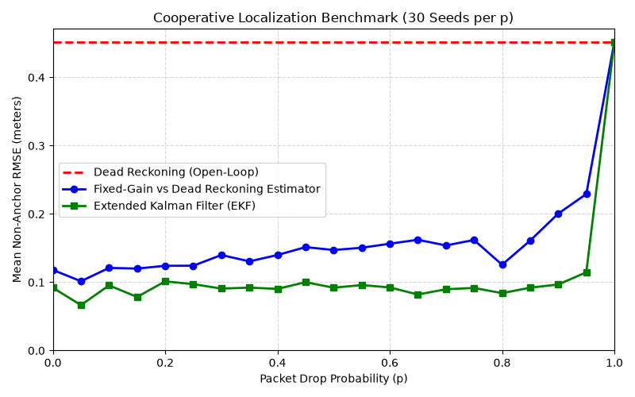

# Cooperative Localisation under Communication Dropout

This is a Python simulation assessing how multi agent localization accuracy degrades under lossy communication links. I am developing this as a benchmark for distributed swarm estimation and research proposals.

## Overview

In multi-agent swarm systems, like autonomous marine vehicles or ground rovers, individual agents within the swarm experience odometric drift over time due to sensor noise and corresponding position calculations. GNSS can correct this drift, but limited power, operational constraints and GNSS spoofing/jamming limit it. Only a small subset of agents ('anchors') can possess accurate coordinates in the simulation.

Unanchored agents rely on **cooperative localisation**, measuring range to neighbouring agents and exchanging state estimation packets. However, wireless channels suffer from packet drops, fading and interference.

This project plots the relationship between **packet drop probability (_p_)** against **position estimation error (RMSE)** so baseline state estimation strategies can be compared against more complex techniques.

## Simulation Setup
* **Fleet**: 6 differential drive dual wheel rovers - (`R=0.12m`, `L = 0.30m`)
    * 2 anchor rovers (with GNSS), 4 non-anchor rovers (GNSS-denied)

* **Time Horizon**: 1000 ticks in ($t \in [0, 10]\text{ s}$)

* **Process & Sensor Noise**:
    * Odometric drift simulated by wheel encoder displacement noise: $\sigma_{\text{enc}} = 0.003\text{ m}$ per wheel per tick
    * ToF ranging noise: $\sigma_{\text{range}} = 0.05\text{ m}$, maximum communication range `6.0 m`

* **Monte Carlo Protocol**: 31 random seeds per packet drop probability $p \in [0.0, 1.0]$ (21 steps) using **Common Random Numbers (CRN)** so all estimators experience identical wheel slip and packet dropouts on each trial

* **Measurements**: Mean Root Mean Square Error (RMSE) across the 4 non-anchor rovers.


## Estimators Compared
1. **Dead Reckoning (`dr`)**
   * Open-loop integration of noisy wheel encoder increments, serves as the upper-bound error
2. **Fixed-Gain Cooperative Observer (`fg`)**
   * Applies range-error corrections along the unit vector using weights (`0.45` for anchor packets, `0.08` for peer rover packets).
3. **Extended Kalman Filter (`ekf`)**
   * Maintains a $3 \times 3$ state covariance matrix $P$ over $[x, y, \psi]$ for each rover.
   * Propagates odometry uncertainty through the differential-drive motion Jacobian $F$ and analytical wheel-noise Jacobian $G$.
   * Dynamically inflates measurement noise $R = \sigma_{\text{range}}^2 + H_s P_s H_s^T$ to account for the transmitting peer's own position uncertainty ($P_s = 0$ for anchors) and updates covariance via the Joseph form for numerical stability.


## Benchmark Results



### Key Takeaways
* **EKF vs. Fixed-Gain:** The EKF consistently achieves lower RMSE for ($p < 1.0$) by adapting its Kalman gain to both accumulated receiver drift and the sender's current covariance
* **Graceful Degradation:** Both cooperative estimators outperform open-loop Dead Reckoning even at high packet drop rates ($p = 0.8\text{–}0.9$), converging cleanly to the Dead Reckoning baseline at $p = 1.0$ when all packets are lost

## Repository Structure

```text
├── agent.py          # Differential-drive kinematics, encoder noise, and covariance propagation
├── estimators.py     # Packet model, Fixed-Gain observer, and Joseph-form EKF update
├── main.py           # Monte Carlo sweep and RMSE plotting script
└── ekf-fg-dr montecarlo.png